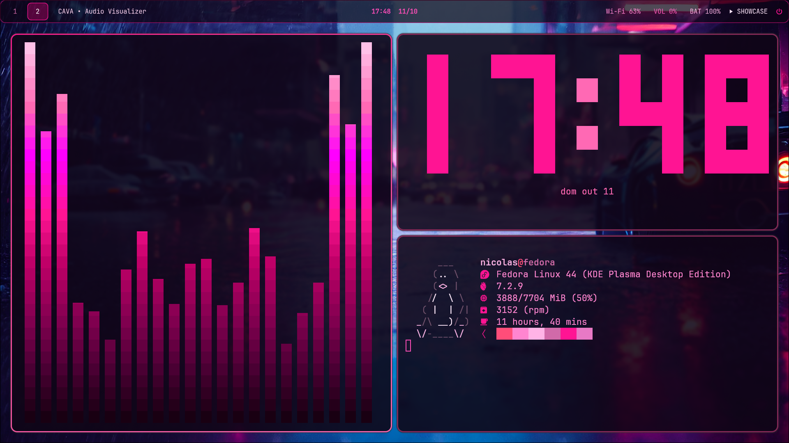

# my.dots

My personal Linux dotfiles and desktop rice, built around **Hyprland** with a clean, customizable Wayland desktop experience.

## Preview

A minimal and personalized desktop setup focused on aesthetics, productivity, and a consistent look across applications.

## Screenshots



## Components

| Component | Description |
|---|---|
| [Hyprland](https://hypr.land/) | Wayland compositor and window management |
| [Waybar](https://github.com/Alexays/Waybar) | Custom status bar with CSS styling and scripts |
| [Wofi](https://hg.sr.ht/~scoopta/wofi) | Application launcher |
| [Cava](https://github.com/karlstav/cava) | Audio visualizer with custom shaders |
| Peaclock | Terminal clock configuration |

## Repository Structure

```text
my.dots/
├── dots/
│   ├── .peaclock/
│   │   └── config
│   ├── cava/
│   │   ├── config
│   │   └── shaders/
│   ├── hypr/
│   │   └── hyprland.lua
│   ├── waybar/
│   │   ├── config.jsonc
│   │   ├── scripts/
│   │   └── style.css
│   └── wofi/
│       ├── config
│       └── style.css
├── screenshots/
│   └── screenshot1.png
├── scripts/
│   ├── install-requirements.sh
│   └── install.sh
├── REQUIREMENTS.md
└── README.md
```

## Installation

**Warning:** The installer backs up existing configurations before replacing them. Review the scripts before running them.

1. Clone the repository:

   ```bash
   git clone https://github.com/Nic24nix/my.dots.git
   cd my.dots
   ```

2. Install the required dependencies:

   ```bash
   ./scripts/install-requirements.sh
   ```

3. Install the dotfiles:

   ```bash
   ./scripts/install.sh
   ```

Read [REQUIREMENTS.md](REQUIREMENTS.md) for the required component versions.

## Backups

The installer stores backups of existing Hyprland, Waybar, Wofi, and Cava configurations under:

```text
~/.local/share/my.dots/backups/
```

## Requirements

This rice is designed for a Linux desktop running Wayland and uses Hyprland, Waybar, Wofi, and Cava.

See [REQUIREMENTS.md](REQUIREMENTS.md) for version information.

## License

No license has been specified yet. All rights reserved unless a license is added to this repository.

